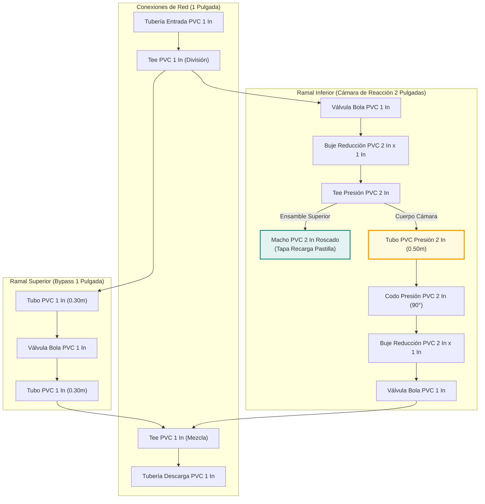
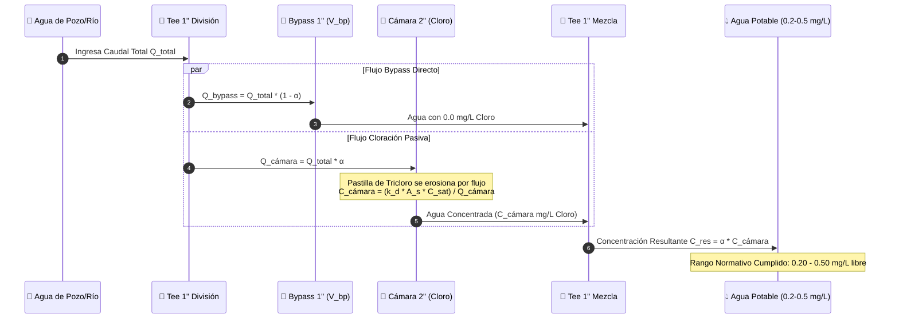

# Especificaciones Técnicas del Prototipo de Clorificador en PVC

**Proyecto**: Diseños y Prototipado de un Clorificador de Agua de Bajo Costo para Zonas Rurales de Montería, Córdoba.  
**Ubicación**: `01_Documentacion_Tecnica/Especificaciones_Tecnicas_Prototipo_PVC.md`  
**Entidad**: Universidad Pontificia Bolivariana (UPB) - Semillero SILOGÍ  
**Docente Asesor**: Ing. Cristian Javier Cano Mogollón  
**Equipo de Trabajo**: roxana muñoz , andrea guzman , camilo

---

## 1. Descripción General del Sistema

El prototipo consiste en un desinfectante pasivo en línea accionado por gravedad, construido con tuberías y accesorios de PVC estándar de presión ($1"$ y $2"$). El sistema utiliza un mecanismo de **división de flujo (Bypass)** que permite regular el porcentaje de agua que ingresa a la cámara de dosificación conteniendo pastillas de cloro, mezclándola posteriormente con el flujo directo para lograr una concentración de cloro residual libre segura e inmunológicamente efectiva en el rango de **$0.2 \text{ a } 0.5 \text{ mg/L}$**.

---

## 2. Componentes y Materiales de Construcción

| Ítem | Elemento / Componente | Especificación Técnica | Cantidad | Función Principal |
| :--- | :--- | :--- | :--- | :--- |
| **1** | Tee de presión 2" | PVC Presión RDE 21 / Schedule 40 | 1 | Aloja y conecta la cámara vertical de cloración. |
| **2** | Codo de presión 2" | PVC Presión RDE 21 | 1 | Redirecciona el flujo en la salida de la cámara. |
| **3** | Macho PVC 2" | Rosca macho PVC NPT 2" | 1 | Permite el cierre roscado y recarga de pastillas. |
| **4** | Bujes de reducción 2" a 1" | Buje de presión PVC | 2 | Acopla la cámara de 2" con las líneas de 1". |
| **5** | Válvulas / Llaves de bola 1" | Válvula de bola PVC 1" | 3 | Regulación manual de flujo (Bypass, Entrada, Salida). |
| **6** | Tee PVC 1" | PVC Presión 1" | 2 | Bifurca y recombina el flujo de entrada y salida. |
| **7** | Tubería PVC 1" | PVC Presión RDE 21 (1.30 m) | 1.3 m | Conducción principal y bypass del agua. |
| **8** | Tubería PVC 2" | PVC Presión RDE 21 (0.50 m) | 0.5 m | Cámara de reacción y contacto con pastilla. |
| **9** | Tapón PVC 1" | Tapón hembra/macho PVC 1" | 1 | Cierre de inspección y drenaje residual. |
| **10** | Soldadura y Limpiador | Pegamento PVC de alta viscosidad | 1 frasco | Sello hermético a prueba de fugas hidrostáticas. |
| **11** | Pastillas de Cloro | Tricloro al 90% / Hipoclorito de Ca | 1 kg | Agente químico oxidante y desinfectante. |

---

## 3. Parámetros de Operación y Diseño Hidráulico

- **Caudal de Operación Diseñado ($Q$)**: $0.2 \text{ L/s} \text{ a } 2.5 \text{ L/s}$ ($12 \text{ L/min} \text{ a } 150 \text{ L/min}$).
- **Presión de Trabajo**: Operación por gravedad (Cabeza hidráulica de $1.5 \text{ m} \text{ a } 5.0 \text{ m}$ de columna de agua, equivalente a $0.15 \text{ a } 0.5 \text{ bar}$).
- **Tiempo de Contacto en Cámara ($t_{\text{res}}$)**: $15 \text{ s} \text{ a } 60 \text{ s}$ en el prototipo, con retención mínima en tanque final de 30 minutos.
- **Mecanismo de Control de Dosificación**: Regulación mediante la apertura relativa de las 3 válvulas ($\%V_{\text{bp}}$, $\%V_{\text{in}}$, $\%V_{\text{out}}$).

---

## 4. Planos, Diagramas P&ID y Esquemas de Flujo del Prototipo

### 4.1 Diagrama P&ID (Piping and Instrumentation Diagram) en Markdown

```mermaid
flowchart LR
    subgraph ALIMENTACION ["1. Fuente Hídrica y Carga"]
        A["🚰 Tanque Elevado / Pozo<br/>(H = 1.5m - 5.0m)"] -->|Agua sin tratar| T1["Tee PVC 1 In<br/>(Nodo de División N1)"]
    end

    subgraph SYSTEM_PVC ["2. Sistema Clorificador en PVC (Bypass Regulado)"]
        direction TB
        
        %% Línea Bypass Directa
        T1 -->|Q_bypass| V_BP["🔴 Válvula Bola 1 In<br/>(V_bp: Bypass Directo)"]
        V_BP -->|Agua Cruda| T2["Tee PVC 1 In<br/>(Nodo de Mezcla N2)"]
        
        %% Línea Cámara de Cloración
        T1 -->|Q_cámara| V_IN["🟢 Válvula Bola 1 In<br/>(V_in: Entrada Cámara)"]
        
        subgraph CAMARA ["Cámara de Dosificación 2 In (L = 0.50m)"]
            BUJE1["Buje Reducción 2 In a 1 In"] --> CAM["🧪 Cámara PVC 2 In<br/>(Pastillas de Tricloro / Hipo 90%)<br/>[Tapa Roscada Macho 2 In]"]
            CAM --> BUJE2["Buje Reducción 2 In a 1 In"]
        end
        
        V_IN --> BUJE1
        BUJE2 --> V_OUT["🟢 Válvula Bola 1 In<br/>(V_out: Salida Cámara)"]
        V_OUT -->|Q_cámara + Cloro Concentrado| T2
    end

    subgraph SALIDA ["3. Mezcla y Distribución Rural"]
        T2 -->|Q_total<br/>Cloro: 0.2 - 0.5 mg/L| TANQUE["🪣 Tanque Retenedor / Red<br/>(Tiempo Contacto >= 30 min)"]
        TANQUE --> HOGARES["🏡 Hogares Comunidad El Vidrial"]
    end

    %% Estilos visuales
    style A fill:#e1f5fe,stroke:#0288d1,stroke-width:2px
    style CAM fill:#fff3e0,stroke:#f57c00,stroke-width:3px
    style V_BP fill:#ffebee,stroke:#c62828,stroke-width:2px
    style V_IN fill:#e8f5e9,stroke:#2e7d32,stroke-width:2px
    style V_OUT fill:#e8f5e9,stroke:#2e7d32,stroke-width:2px
    style HOGARES fill:#f3e5f5,stroke:#7b1fa2,stroke-width:2px
```

---

### 4.2 Plano Despiezado y Cotas de Ensamble Físico en PVC

---

### 4.3 Diagrama de Secuencia Operativa y Balance de Cloración

---

## 5. Mantenimiento y Procedimiento de Recarga

1. **Recarga de Pastilla**: Cerrar $V_{\text{in}}$ y $V_{\text{out}}$, desenroscar el adaptador macho de 2", insertar 1 o 2 pastillas de Tricloro de 1" u 2", roscar con cinta teflón y reaprir las válvulas en la posición calibrada.
2. **Purga y Limpieza**: Abrir el tapón de 1" semanalmente para eliminar sedimentos o lodos depositados en la base de la cámara.
