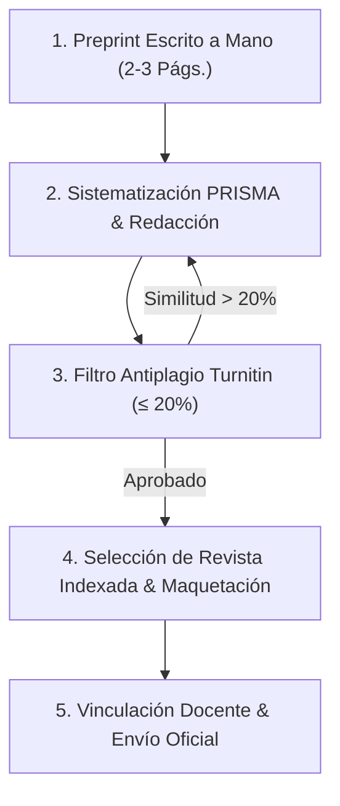

# 📘 Guía Pedagógica del Estudiante: Cierre del Proyecto, Preprint PRISMA y Postulación a Revista Indexada
### Asignatura: Gestión Tecnológica (`Código: 8830 0048 0`)
**Universidad Pontificia Bolivariana — Seccional Montería**  
**Facultad de Ingeniería Industrial // Grupo de Investigación SILOGE // Hub Industrial Solution (HIS)**  
**Docente Titular:** M.Sc. Cristian Javier Cano Mogollón  
**Periodo:** 2026-2

---

## 🎯 Objetivo de la Actividad
Capacitar al estudiante de ingeniería industrial en el ciclo completo de divulgación y transferencia científica internacional, aprendiendo a estructurar su proyecto de clase bajo rigor editorial estandarizado: desde la concepción manuscrita original y el mapeo sistemático de literatura (**PRISMA**), pasando por la auditoría de originalidad (**Turnitin**), hasta la maquetación y radicación formal en una revista indexada reconocida por MinCiencias.

---

## 🧭 Ruta Metódica en 5 Pasos



---

### Paso 1: El Borrador de Preprint Escrito a Mano (2 a 3 páginas)
Para garantizar la apropiación profunda de la investigación y erradicar la generación automatizada no reflexiva:
1. Redacten a mano (en hojas de examen o papel cuadriculado) un resumen estructurado del proyecto de 2 a 3 páginas.
2. Debe contener obligatoriamente:
   * **Título preliminar:** Claro, técnico y representativo del contexto industrial abordado.
   * **Problema y Brecha:** Estado inicial del problema en las empresas de Montería o Córdoba y necesidad tecnológica.
   * **Esquema PRISMA Dibujado:** Diagrama de flujo que ilustre las 4 fases de búsqueda de literatura (Identificación $\to$ Cribado $\to$ Elegibilidad $\to$ Inclusión).
   * **Formulación del Modelo:** Ecuaciones, formulación matemática o algoritmo base de la solución (con definición de variables e índices).
   * **Síntesis de Hallazgos y Discusión:** Conclusiones principales del impacto técnico u operativo.
3. Escanear el manuscrito en formato PDF nítido (con CamScanner, Adobe Scan o escáner de cama plana) para ser anexado en la entrega.

---

### Paso 2: La Metodología PRISMA para el Manuscrito
La declaración **PRISMA (Preferred Reporting Items for Systematic Reviews and Meta-Analyses)** debe ser el estándar para sustentar el estado del arte y la vigilancia tecnológica del artículo:
* **Identificación:** Definición de bases de datos consultadas (Scopus, ScienceDirect, IEEE Xplore, SciELO, Redalyc) y ecuación booleana formal utilizada (ejemplo: `("technology management" OR "digital transformation") AND ("SMEs" OR "small and medium enterprises") AND ("optimization")`).
* **Cribado (Screening):** Criterios de depuración aplicados (artículos duplicados eliminados, filtros temporales 2020-2026, áreas de ingeniería).
* **Elegibilidad:** Lectura de títulos, resúmenes y texto completo frente a criterios de inclusión y exclusión definidos por el equipo.
* **Inclusión:** Número final de artículos científicos que constituyen la base teórica y comparativa del proyecto.
* *El diagrama de flujo PRISMA debe insertarse como Figura 1 o Figura 2 en el cuerpo del artículo.*

---

### Paso 3: Auditoría de Integridad Académica con Turnitin ($\le 20\%$)
Antes de proceder a la maquetación final y envío:
1. Pasar el borrador digitalizado del artículo por el canal oficial de **Turnitin** asignado por la Universidad o el docente.
2. **Parámetros de configuración:**
   * Excluir bibliografía / referencias al final del documento.
   * Excluir citas textuales entre comillas.
   * No excluir fuentes menores.
3. **Criterio de aprobación:** El índice general de similitud debe ser **estrictamente menor o igual al 20%**, y ningún bloque de texto continuo puede superar el 2% de coincidencia con una sola fuente.
4. Generar el reporte oficial en PDF de Turnitin (con el desglose de fuentes resaltadas) y adjuntarlo como `Certificado_Turnitin_EquipoNN.pdf`.

---

### Paso 4: Selección de Revista Indexada y Maquetación
1. Consultar bases de datos científicas para seleccionar la revista objetivo:
   * **Publindex (MinCiencias Colombia):** Revistas Categorías A1, A2, B o C (ej. *Revista UIS Ingenierías*, *TecnoLógicas*, *DYNA*, *Ingeniería y Competitividad*, *Ciencia y Tecnología Agropecuaria*, etc.).
   * **Scopus / WoS:** Cuartiles Q1 a Q4 en áreas de Industrial and Manufacturing Engineering, Management of Technology and Innovation, o Computer Science Applications.
2. Descargar de la web oficial de la revista:
   * La **Guía para Autores (*Author Guidelines*)**.
   * La **Plantilla Oficial (*Template*)** en Word o LaTeX.
3. Maquetar el artículo completo adaptando títulos, márgenes, tipo de letra, figuras, tablas y estilo de referencias (típicamente IEEE o APA 7) a las exigencias exactas de la revista.

---

### Paso 5: Vinculación Obligatoria del Docente y Radicación
1. **Filiación y Créditos de Autoría:**
   Todos los artículos deben incluir formalmente al docente titular como co-investigador / co-autor:
   ```text
   Autor 1: [Nombre del Estudiante 1] - Universidad Pontificia Bolivariana Seccional Montería
   Autor 2: [Nombre del Estudiante 2] - Universidad Pontificia Bolivariana Seccional Montería
   ...
   Co-Autor / Co-Investigador: M.Sc. Cristian Javier Cano Mogollón
   Filiación: Docente Titular, Facultad de Ingeniería Industrial. 
   Grupo de Investigación en Simulación, Logística y Gestión de Operaciones (SILOGE), 
   Hub Industrial Solution (HIS), Universidad Pontificia Bolivariana, Seccional Montería, Colombia.
   Correo: cristian.cano@upb.edu.co
   ```
2. **Proceso de Radicación (Submission):**
   * Crear la cuenta de autor en la plataforma editorial de la revista (Open Journal Systems - OJS, Editorial Manager, ScholarOne).
   * Diligenciar los metadatos completos (título en inglés y español, abstract, keywords, autores y filiaciones).
   * Cargar el archivo del artículo anonimizado (si la revista es doble ciego) o completo según sus instrucciones.
   * Descargar o capturar el comprobante oficial de envío (*Submission Acknowledgment*) emitido por el sistema con la fecha, título y código de radicado asignado.

---

## 📦 Lista de Chequeo Final de Entrega

- [ ] Borrador manuscrito original a mano (2-3 páginas) escaneado.
- [ ] Diagrama de flujo PRISMA completo integrado en el artículo.
- [ ] Certificado Turnitin generado con similitud $\le 20\%$.
- [ ] Ficha técnica de la revista indexada (A1-C o Scopus/WoS) con enlace web oficial.
- [ ] Manuscrito 100% maquetado en la plantilla oficial de la revista.
- [ ] M.Sc. Cristian Javier Cano Mogollón incluido como co-autor con filiación SILOGE/HIS/UPB.
- [ ] Constancia de radicación/envío oficial emitida por la revista.
